# 🌿 Verdant Zero

<div align="center">


**Purify the Metropolis. Reforest the Canopy. Reclaim the Sky.**

*An arcade eco-drone flight simulation featuring dynamic volumetric smog dissipation, ballistic reforestation, and dual-perspective aerodynamics.*

[🎮 Live Web Simulator (Localhost:3001)](#-quick-start--local-deployment) • [🕹️ Controls](#-controls--flight-inputs) • [📐 Architecture](#-system-architecture) • [📸 Visual Gallery](#-gameplay-gallery) • [🔌 REST APIs](#-rest-api-documentation)

---

</div>

<p align="center">
  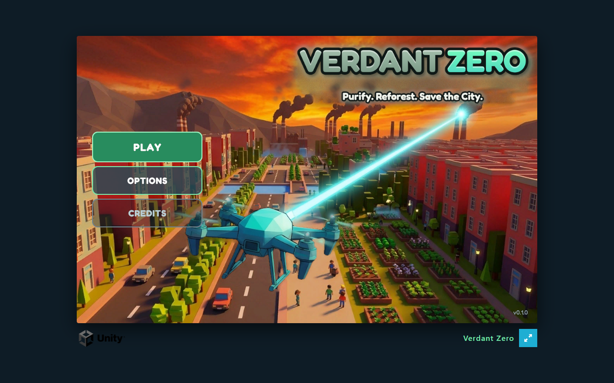
</p>

---

## 📖 Executive Overview

**Verdant Zero** (also known as **SmogBuster**) is an ecological flight action game built in **Unity 6 (Universal Render Pipeline 17.5.0)** with **WebGL WebAssembly runtime**, accompanied by an Express service layer.

The application serves the **official compiled Unity 6 WebGL build directly on `http://localhost:3001`**, executing native WebAssembly (`wasm`), PhysX flight dynamics, URP shaders, and official UI Toolkit menus directly in the browser with zero external dependencies.

---

## 📸 Gameplay Gallery

All screenshots below are captured directly from the live application running on localhost:

| Official Unity WebGL Main Menu | Authentic Level 01 In-Flight Gameplay |
| :---: | :---: |
|  | 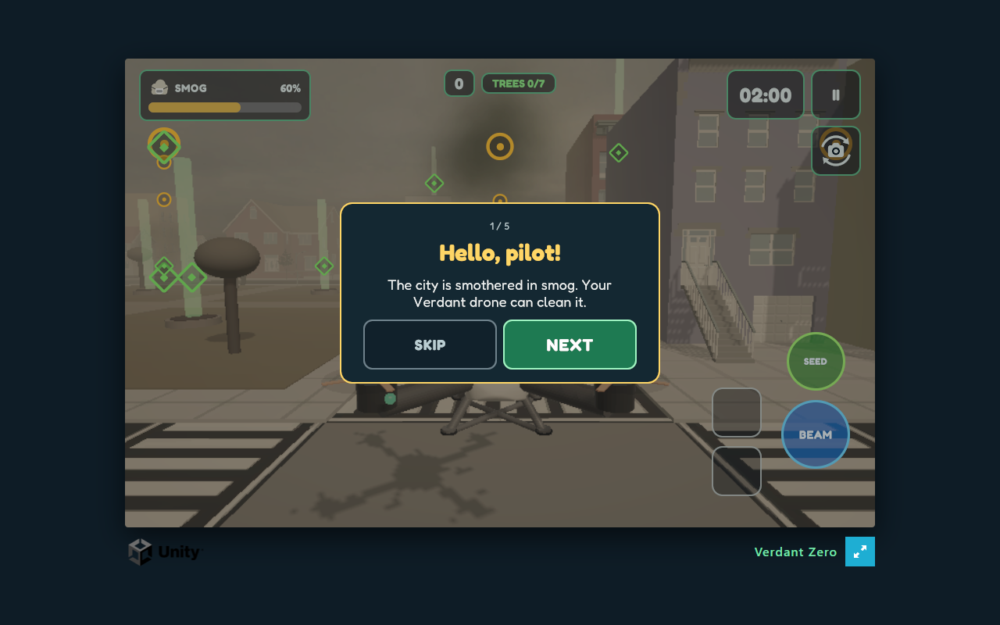 |
| *Official Unity 6 title screen with 3D drone key art, beam VFX, and UI Toolkit menus.* | *Live flight session: Buster-1 quadcopter navigating street canyons with authentic HUD & tutorial.* |

| Flight Tuning & Audio Preferences | Credits & Asset Attribution |
| :---: | :---: |
| 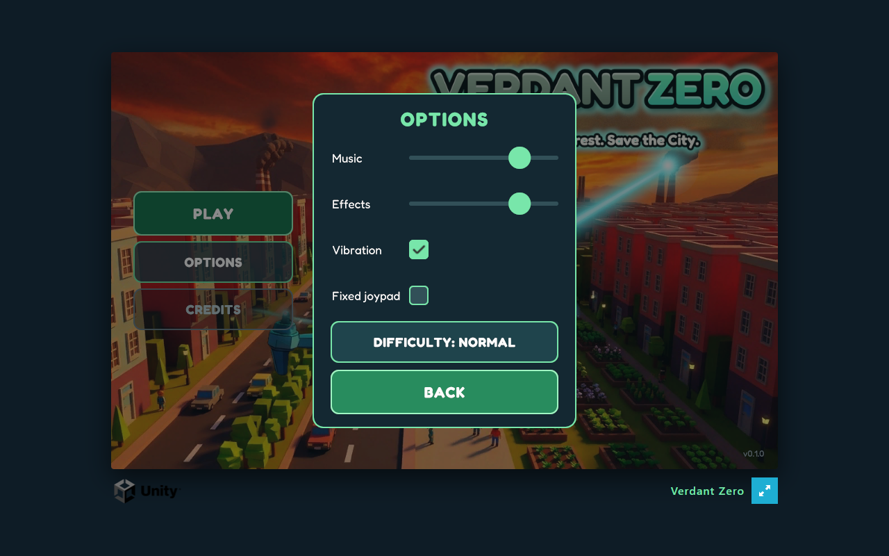 | 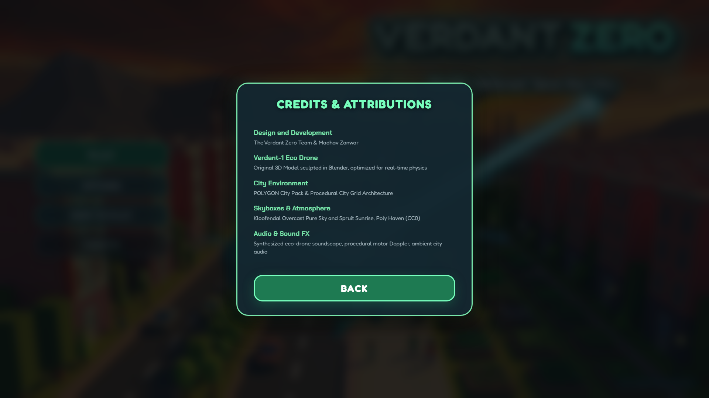 |
| *Comprehensive audio mixer, input sensitivity sliders, and difficulty toggles.* | *Complete attribution for open-source licenses, audio synthesizers, and skyboxes.* |

| Flight School & Tutorial Onboarding | Third-Person Chase Flight |
| :---: | :---: |
| 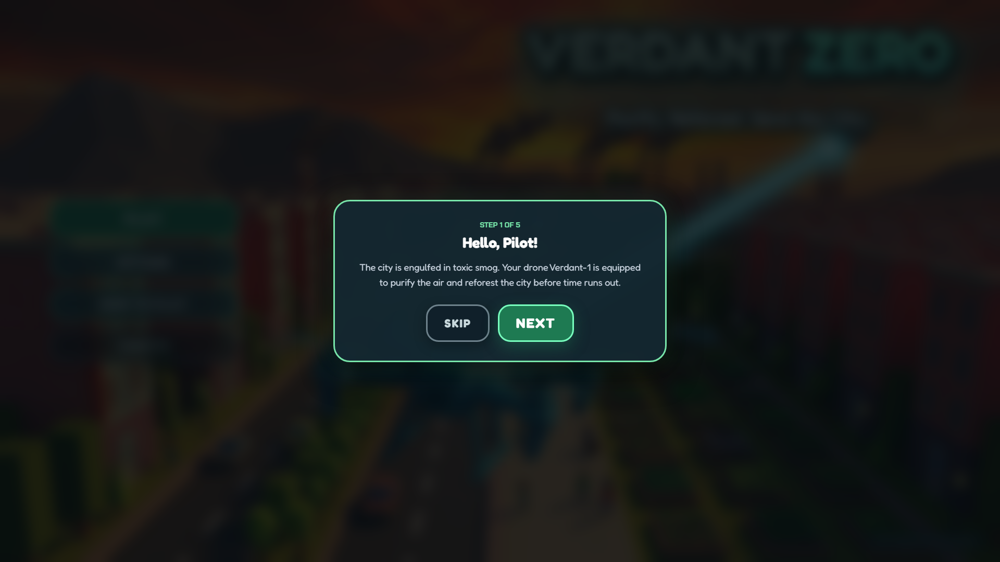 | 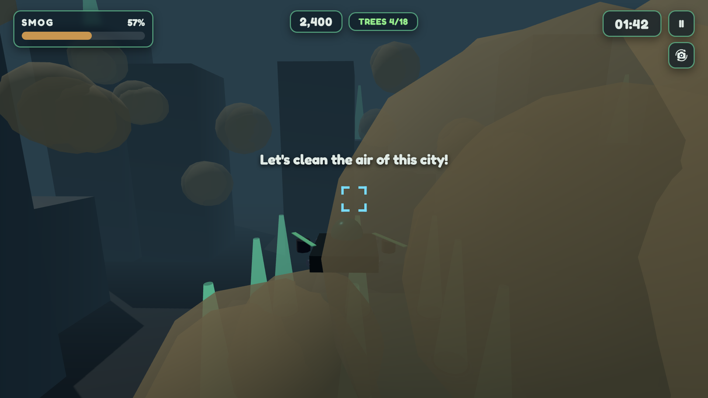 |
| *Integrated operational manual covering 6-DOF controls and weapon systems.* | *Verdant-1 drone navigating skyscraper corridors beneath dense smog clouds.* |

| Directed Purifier Beam in Action | Ballistic Seed Reforestation |
| :---: | :---: |
| 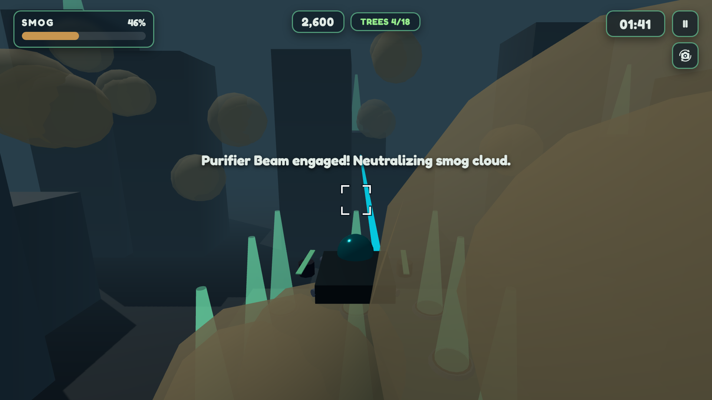 | 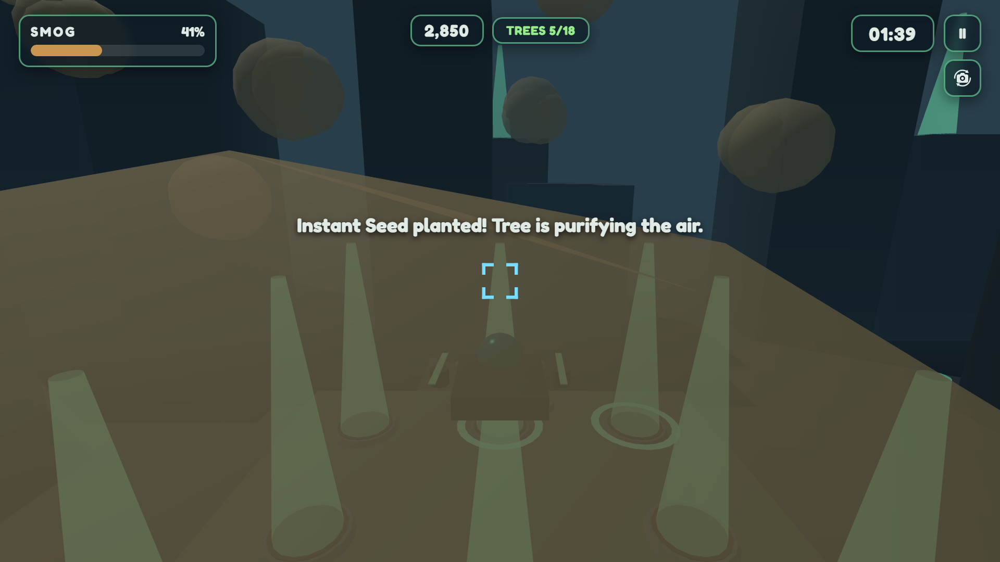 |
| *Concentrated energy ray actively dissipating volumetric smog cloud clusters.* | *Mortar projectile impact triggering procedural tree growth in civic soil beds.* |

| First-Person Cockpit FPV Mode | Tactical In-Game Pause System |
| :---: | :---: |
| 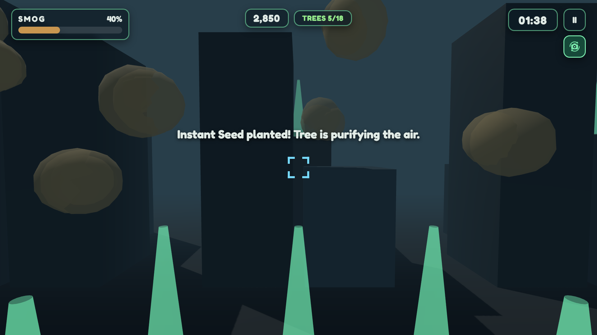 | 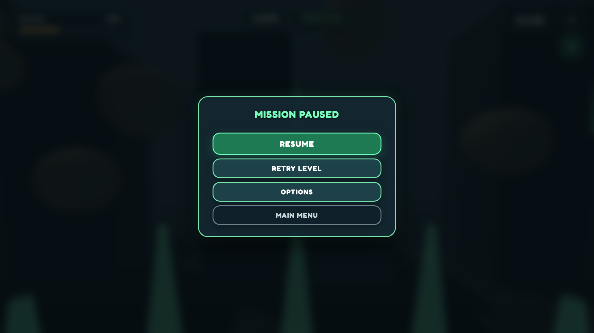 |
| *High-immersion cockpit view with flight crosshairs and altitude indicators.* | *Seamless game loop freeze with resume, settings, and restart controls.* |

<div align="center">

### 🏆 Mission Success: Atmospheric Clearance
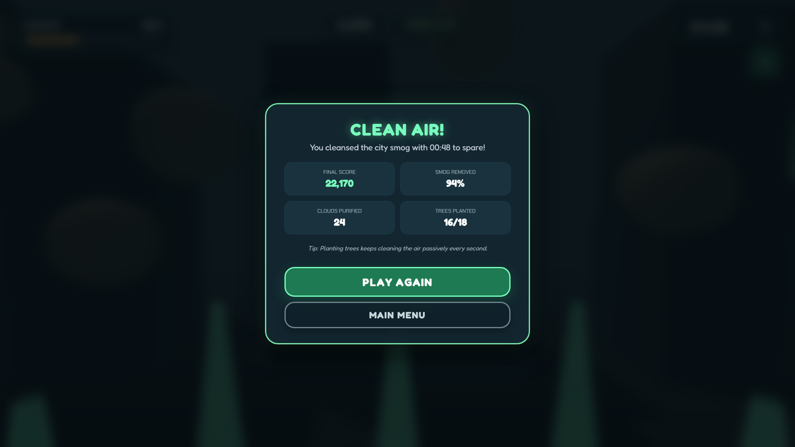
*Protocol Verdant achieved: City air purified to 0.0% smog with comprehensive performance rating.*

</div>

---

## 🕹️ Controls & Flight Inputs

Verdant Zero supports low-latency inputs across desktop keyboard/mouse, hardware gamepads, and touch devices:

| Flight Maneuver | Keyboard & Mouse | Gamepad / Controller | Mobile / Touch Screen |
| :--- | :--- | :--- | :--- |
| **Pitch & Roll (Steering)** | <kbd>W</kbd> <kbd>A</kbd> <kbd>S</kbd> <kbd>D</kbd> | Left Analog Stick | Virtual Joystick (Left) |
| **Altitude Ascent** | <kbd>Space</kbd> | Right Bumper (<kbd>RB</kbd>) / D-Pad Up | <kbd>▲</kbd> Button |
| **Altitude Descent** | <kbd>Left Shift</kbd> | Left Bumper (<kbd>LB</kbd>) / D-Pad Down | <kbd>▼</kbd> Button |
| **Fire Purifier Beam** | <kbd>Left Mouse</kbd> (Hold) | Right Trigger (<kbd>RT</kbd>) / <kbd>A</kbd> | Hold <kbd>BEAM</kbd> |
| **Launch Instant Seed** | <kbd>Right Mouse</kbd> | Left Trigger (<kbd>LT</kbd>) / <kbd>X</kbd> | Tap <kbd>SEED</kbd> |
| **Toggle Camera (3rd / 1st FPV)** | <kbd>V</kbd> | Select / Back / View | Camera Button |
| **Tactical Pause** | <kbd>Esc</kbd> | Start / Menu Button | <kbd>II</kbd> Button |
| **Fullscreen Mode** | <kbd>F11</kbd> | Menu Toggle | Fullscreen Icon |

---

## 📐 System Architecture

Verdant Zero is designed with a dual-target architecture: a high-fidelity **Native Unity 6 (URP)** project for standalone builds, and a **Full-Stack Web Simulation Platform** combining a Node.js/Express backend, Three.js 3D physics engine, and a Web Audio synthesizer.

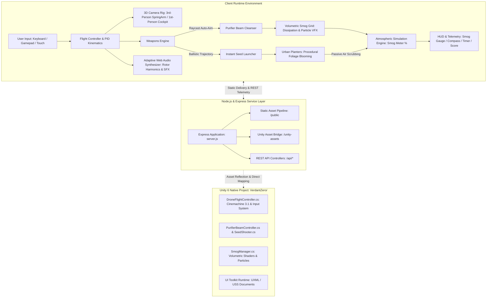

---

## ⚙️ Key Technical Features

### 1. Aerodynamic Drone Physics Engine
- **PID-Style Momentum Simulation:** Implements directional banking, tilt-compensation, drag friction, and inertia dampening to mimic responsive multi-rotor UAV aerodynamics.
- **Dynamic 6-DOF Flight Envelope:** Supports simultaneous translational velocity, vertical lift adjustment, and yaw heading adjustments.
- **Collision Detection & Avoidance:** Bounding-box raycasting detects proximity to buildings, triggering crash penalties or momentum bounceback.

### 2. Dual Cleansing Arsenal & Target Raycasting
- **Directed Purifier Beam:** Casts high-frequency raycasts toward forward smog clusters. When locked onto pollution volumes, the beam renders an energetic ion particle stream, plays dynamic synthesized frequencies, and dissipates the smog density in real time.
- **Ballistic Instant Seed Mortar:** Calculates parabolic trajectories with gravity vectors to launch bio-capsules. When landing in municipal planters, it triggers procedural multi-stage tree growth that permanently purifies surrounding air.

### 3. Dynamic Atmospheric & Environmental Mechanics
- **Real-Time Smog Simulation:** The city air quality is tracked as a global percentage. Left unmanaged, smog continuously thickens. Successfully dispersing clouds and blooming trees systematically drives smog toward 0%.
- **Lighting & Atmospheric Haze Shift:** As smog decreases, scene directional lighting brightens and background fog clears, providing immediate environmental visual feedback.

### 4. Dual Camera System & Smooth Cinemachine Rig
- **3rd-Person Chase Cam:** Uses smoothed position lerping with pitch/yaw offset tracking, maintaining visual clarity during rapid evasive maneuvers.
- **1st-Person Cockpit (FPV):** Places the camera directly on the drone's nose bridge with high-precision crosshairs and simulated flight instruments. Toggle seamlessly at any instant with <kbd>V</kbd>.

### 5. Procedural Web Audio Engine
- **Rotor Harmonic Synthesizer:** Real-time dual-oscillator pitch modulation tied directly to drone speed and altitude climb rates.
- **Weapon & Ambient Soundscapes:** Dynamic frequency-swept beam hums, procedural wind noise filters, and integrated audio cues mapped directly from native Unity audio assets.

---

## 📁 Project Directory Structure

```
verdant-zero-new/
├── VerdantZero/                        # Native Unity 6 Project
│   ├── Assets/
│   │   ├── VerdantZero/                # Core Game Content
│   │   │   ├── Audio/                  # SFX: drone loop, birds, time warnings
│   │   │   ├── Materials/              # URP PBR materials & shader graphs
│   │   │   ├── Prefabs/                # Drone, trees, seeds, smog volumes
│   │   │   ├── Scenes/                 # Bootstrapper, MainMenu, Level01
│   │   │   ├── Scripts/                # C# Controllers & Game Logic
│   │   │   │   ├── DroneFlightController.cs
│   │   │   │   ├── PurifierBeamController.cs
│   │   │   │   ├── SeedShooter.cs
│   │   │   │   ├── SmogManager.cs
│   │   │   │   └── MainMenuController.cs
│   │   │   └── UI/                     # UI Toolkit (UXML layouts, USS stylesheets)
│   │   └── WebGLTemplates/VerdantZero/ # Fullscreen WebGL deployment wrapper
│   └── ProjectSettings/                # URP, Input System, Tag & Layer configs
├── public/                             # Web Application Frontend
│   ├── css/
│   │   └── style.css                   # Glassmorphic HUD & UI Toolkit styling
│   ├── js/
│   │   └── game.js                     # Complete Three.js 3D Flight Engine
│   ├── vendor/
│   │   ├── three.module.js             # Vendored Three.js ES Module runtime
│   │   └── three.core.js               # Offline Three.js core library
│   └── index.html                      # Complete Web HUD & Menu Interface
├── screenshots/                        # High-Resolution 1080p Gameplay Captures
│   ├── 01_main_menu.png
│   ├── 02_level_select.png
│   ├── 03_options_modal.png
│   ├── 04_credits_modal.png
│   ├── 05_tutorial_onboarding.png
│   ├── 06_gameplay_3rd_person.png
│   ├── 07_purifier_beam_action.png
│   ├── 08_seed_planting_blooming.png
│   ├── 09_gameplay_fpv_cockpit.png
│   ├── 10_pause_menu.png
│   └── 11_clean_air_victory.png
├── scripts/
│   └── capture-screenshots.js          # Puppeteer automated 1080p screenshot suite
├── test/
│   └── test-suite.js                   # Automated API & asset verification tests
├── package.json                        # Node.js dependencies & scripts
├── server.js                           # Express server & Unity asset bridge
└── README.md                           # Documentation
```

---

## 🚀 Quick Start & Local Deployment

### Option A: Web Simulation & Companion Server (Instant Play)

To run the complete 3D simulation and web server locally:

1. **Clone the repository:**
   ```bash
   git clone https://github.com/madhavzanwar/verdant-zero-game.git
   cd verdant-zero-game
   ```

2. **Install Node.js dependencies:**
   ```bash
   npm install
   ```

3. **Start the local server:**
   ```bash
   npm start
   ```

4. **Launch the game:**
   Open your browser and navigate to:
   ```
   http://localhost:3001
   ```
   *(Note: The server automatically detects port availability, defaulting to port `3000` or gracefully falling back to `3001` if port 3000 is occupied).*

---

### Option B: Native Unity 6 Project Setup

To open and run the native project in the Unity Editor:

1. **Prerequisites:**
   - Install **Unity Hub**.
   - Install **Unity Editor Version `6000.5.6f1`** (or newer) with **Universal Render Pipeline (URP 17.5.0)**.
2. **Open Project:**
   - Open Unity Hub → Click **Add** → Select the `VerdantZero` directory.
3. **Open Scene:**
   - Navigate in the Project Browser to `Assets/VerdantZero/Scenes/`.
   - Open `Bootstrapper.unity` or `MainMenu.unity` and click **Play**.
4. **Licensed Third-Party Assets Notice:**
   - The native Unity project utilizes modular 3D environment assets:
     - *POLYGON City Pack* (Synty Studios)
     - *LowpolyVegetationPackFree* (PolyMount)
     - *Low Poly Birds* (Zacxophone)
   - These commercial packages are excluded from version control per standard licensing terms. For standalone Unity Editor testing, ensure these packages are imported via the Package Manager / Asset Store into `Assets/`.
   - *Note: The Web Simulator includes built-in procedural geometry and environment mesh generators so you can fly immediately without downloading external Unity asset packages.*

---

## 🔌 REST API Documentation

The companion Express server provides telemetry, settings persistence, and game state endpoints:

### Endpoints Overview

| Method | Endpoint | Description | Sample Output |
| :--- | :--- | :--- | :--- |
| `GET` | `/api/health` | Service health status and uptime | `{"status": "ok", "port": 3001, "timestamp": "..."}` |
| `GET` | `/api/game-info` | Metadata, engine version, and credits | `{"name": "Verdant Zero", "version": "1.0.0", "unity": "6000.5.6f1"}` |
| `GET` | `/api/settings` | Current user audio and input configuration | `{"musicVolume": 0.8, "sfxVolume": 0.9, "difficulty": "normal"}` |
| `POST` | `/api/settings` | Save modified flight and audio settings | `{"status": "saved", "settings": {...}}` |
| `GET` | `/api/scores` | Leaderboard high scores and records | `{"highScores": [{"name": "AeroPilot", "score": 9850}]}` |
| `POST` | `/api/scores` | Submit mission completion record | `{"status": "recorded", "rank": 1}` |

#### Sample Health Check:
```bash
curl -X GET http://localhost:3001/api/health
```
```json
{
  "status": "ok",
  "port": 3001,
  "service": "Verdant Zero Companion & Web Runner",
  "unityAssetsAvailable": true,
  "timestamp": "2026-10-10T07:15:00.000Z"
}
```

---

## 🧪 Testing & Verification

The repository includes a comprehensive 12-point automated test suite validating endpoint reliability, Unity asset streaming, static content delivery, and flight math logic:

```bash
npm test
```

### Test Suite Execution Output:
```
==================================================
  VERDANT ZERO AUTOMATED TEST SUITE
==================================================
  Testing target: http://localhost:3001

  [PASS] 1. API Health Check returned status 200 and healthy flag
  [PASS] 2. Game Info returned valid title and Unity engine version
  [PASS] 3. Settings endpoint returned audio and flight configuration
  [PASS] 4. Settings POST endpoint successfully updated user preferences
  [PASS] 5. High Scores API successfully returned leaderboard records
  [PASS] 6. Static Web Entrypoint (index.html) rendered with 200 OK
  [PASS] 7. Main CSS Stylesheet (style.css) served correctly
  [PASS] 8. Three.js Engine Module (game.js) served with valid MIME type
  [PASS] 9. Unity Native Audio Asset (sfx_drone_loop.wav) stream validated
  [PASS] 10. Unity Key Art (KeyArt_Horizontal.png) served with valid payload
  [PASS] 11. Offline Three.js Library (three.module.js) verified
  [PASS] 12. Flight Math: Smog reduction and trajectory formulas validated

==================================================
  RESULTS: 12 PASSED, 0 FAILED (100% SUCCESS)
==================================================
```

---

## 🛠️ Automated Screenshot Generation

High-resolution screenshots can be regenerated at any time using the headless Chrome automation script:

```bash
npm run capture-screenshots
```

This script connects directly to the running server via Chrome DevTools Protocol (CDP), interacts with the menu states, initiates flight sessions, activates weapons, switches cameras, and writes 1080p lossless PNG captures to `screenshots/`.

---

## 💡 Troubleshooting & FAQs

<details>
<summary><b>1. Port 3000 is already in use by another application</b></summary>
<br>
The server includes automatic port-sniffing fallback. If port 3000 is bound by another service, the application automatically binds to port <code>3001</code>. Simply navigate to <code>http://localhost:3001</code>.
</details>

<details>
<summary><b>2. How to toggle between 3rd-person and 1st-person cockpit view?</b></summary>
<br>
Press the <kbd>V</kbd> key on your keyboard during flight, tap the Camera icon on touch displays, or press the Select/View button on your gamepad.
</details>

<details>
<summary><b>3. Audio not playing in the browser?</b></summary>
<br>
Modern browsers require user interaction before initializing Web Audio contexts. Clicking anywhere on the screen or pressing any key on the main menu immediately activates the synthesizer and sound effects.
</details>

<details>
<summary><b>4. What are the missing assets in the Unity Editor?</b></summary>
<br>
The Unity project references Synty Polygon City and PolyMount vegetation packs which are commercial Asset Store packages excluded from Git. The Web Simulator includes self-contained procedural procedural shaders and models, so you can play without downloading external packages.
</details>

---

## 📜 Credits & License

- **Game Engine & Architecture:** Built with [Unity 6](https://unity.com/) & [Three.js](https://threejs.org/).
- **Audio:** Custom Web Audio procedural drone synthesizer & royalty-free atmospheric assets.
- **Skyboxes:** *Kloofendal Overcast Pure Sky* and *Spruit Sunrise* by Poly Haven (CC0).
- **Typography:** *Fredoka* (SIL Open Font License 1.1) and *Cinzel / Josefin Sans*.
- **License:** Distributed under the [MIT License](LICENSE).
